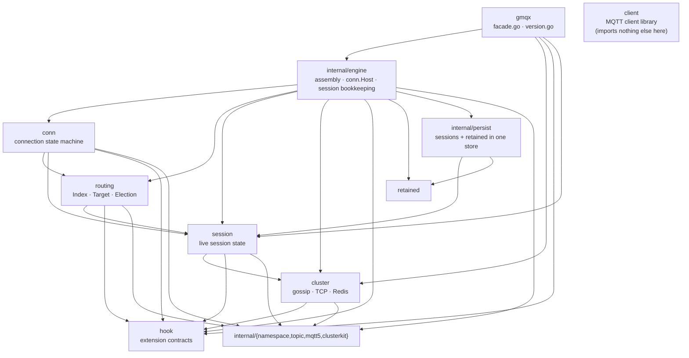
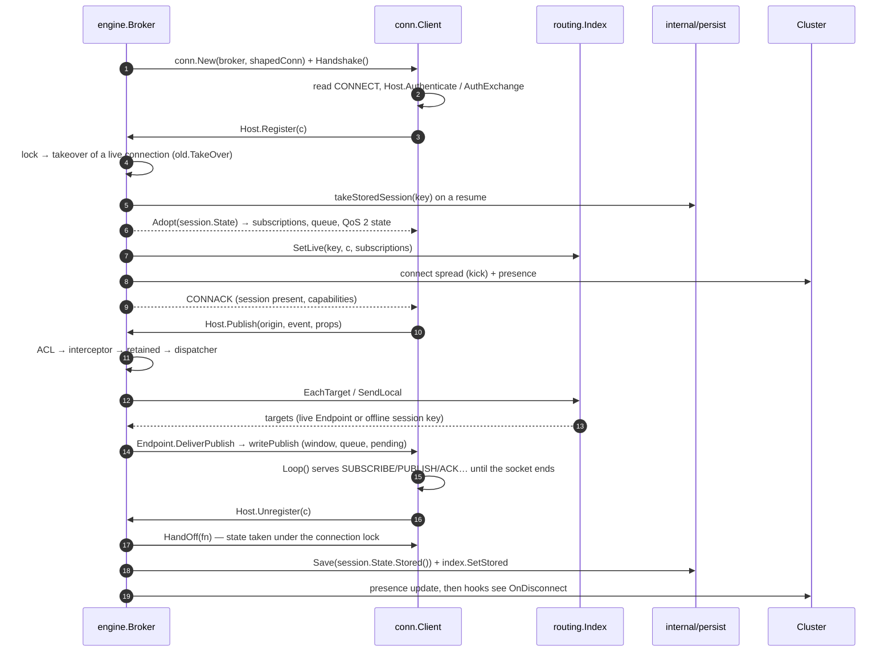
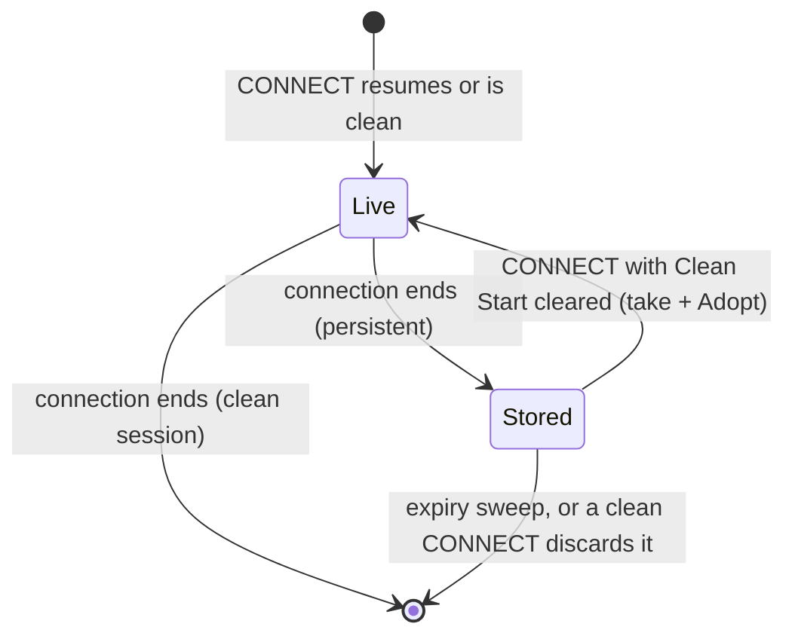

English | [简体中文](ARCHITECTURE.zh-CN.md)

# Architecture: where the code lives and why

> Applies to the current tree (2026-11-02). The rules behind it are recorded in
> the platform repository's `docs/design/source-layout.md`; this document is the
> package-level map for this repository.

gmqx is one import path and one engine. `github.com/maxid/gmqx` is the **only
public package**: it declares no behavior, it re-exports types from the packages
below. Everything else is either a public role package that a consumer may import
directly — `hook`, `cluster`, `session`, `routing`, `conn`, `client`, `retained` —
or internal.

The split exists because the broker is not one thing: a physical connection, the
routing table, the session state, the cluster backends and the extension
contracts change for different reasons. Each has a package; the assembly layer
(`internal/engine`) is the only place that knows all of them.

## Packages

| Package | Role | Key declarations |
|---|---|---|
| `gmqx` (root) | **Facade only**: `facade.go` holds the package doc and every alias/forward, `version.go` the version. Two non-test files, no logic. | `Broker`, `Config`, `Publication`, `LocalTarget`, `Dispatcher`, the error values, the hook aliases |
| `internal/engine` | **Assembly**: broker lifecycle (`New`/`Start`/`Stop`), the clientId table and takeover rules, the session bookkeeping (store take/save/sweep, offline queue and caps), the pending-will scheduler, the plugin host, and the `conn.Host` implementation. | `Broker`, `Config`, `Errors`, `conn.Host` methods |
| `internal/persist` | **The persistence seam**: one gcache store holds both records (a persistent session, a retained message), with the key scheme, the TTL rule, the versioned encoding and the atomic take. | `Store`, `New`, `SaveSession`/`TakeSession`, `SaveRetained`/`Retained` |
| `conn` | **One physical connection**: CONNECT/AUTH handshake, read loop, write-behind queue and its writer goroutine, outbound QoS 1/2 window with one retransmission timer, the will decision, byte-rate shaping. Talks to the broker only through `conn.Host`. | `Client`, `Host`, `Limits`, `Origin`, `Handoff`, `Shaping` |
| `routing` | **Routing table and shared-subscription election**: exact/wildcard buckets, per-filter live counts, shared groups with their round-robin cursor, stored-session entries, and the cluster-wide choice of the node that delivers a shared publication. Holds `routing.Endpoint`, never a connection type. | `Index`, `Target`, `Endpoint`, `Election` |
| `session` | **The live session state**: the subscriptions, the queue and the QoS 2 state a connection hands to its host. The stored form is `internal/persist`'s. | `State`, `Pending`, `Subscription`, `Inflight` |
| `cluster` | **Cluster backends**: the contract and event types, the gossip (default), TCP-mesh and Redis backends, and the observable views (`StatsView`, `LinkView`, `PresenceView`, `RoutingView`). | `Cluster`, `ClusterMessage`, `NewGossipCluster`, `NewTCPCluster`, `NewRedisCluster` |
| `hook` | **Extension contracts**: authentication, ACL, event sink, metrics, interceptor, connection info, payload codecs and the plugin host slots. | `AuthManager`, `AclManager`, `EventSink`, `MetricsManager`, `Interceptor`, `Codec`, `Host` |
| `retained` | **The retained hot table**: the in-memory copy a SUBSCRIBE scans, with the Message Expiry deadline. The durable copy is `internal/persist`'s. | `Table`, `Message` |
| `client` | **MQTT client library** (the outbound side). Independent of the broker: imports no other gmqx package. | `Client`, `Config` |
| `internal/{namespace,topic,mqtt5,clusterkit}` | Shared rules, not a role: key scoping, topic filters, MQTT 5 property and subscription-identifier rules, cluster dedup and summary. | — |

## Dependency direction



Three rules hold this shape, and the build enforces all three:

1. **Nobody imports the root package.** The arrow only ever points away from
   `gmqx`. A subpackage that imported the root would be a cycle, or a sign that
   the type it wants belongs in the subpackage.
2. **The engine imports roles; roles never import the engine.** `internal/engine`
   may call `conn`, `routing`, `session`, `cluster`; none of them calls back. The
   connection's need for the broker is the `conn.Host` **interface**, implemented
   by `*engine.Broker` — so `conn` does not know the engine exists, and a test can
   run a connection against a small fake host.
3. **Only the root is public, and the engine is `internal/`.** `go doc` on
   `github.com/maxid/gmqx` lists the API; `github.com/maxid/gmqx/internal/engine`
   is not importable from outside the module. The root's aliases are what make
   `gmqx.Broker` and `engine.Broker` the same type.

## One connection's life



Two details are load-bearing:

- **The session handoff is one critical section.** `conn.Client.HandOff` (and
  `TakeOver` for a take-over) runs the broker's callback with the connection lock
  held, and only after it returns does the connection stop owning its queue. That
  is what makes "the state is stored" and "a new delivery is queued for the
  offline session" mutually exclusive: a delivery cannot land on a socket whose
  session was just written.
- **Routing sees an interface, not a connection.**
  `routing.Endpoint` is `ClientID()`, `ConnectionID()` and `DeliverPublish(...)` —
  the three things the table needs, and the identity comparison that lets a
  displaced connection's SUBSCRIBE be ignored.

## Where a session lives



While a session is **Live**, `conn.Client` owns it: subscriptions, the queue it
drained after the CONNACK, the inbound QoS 2 packet ids and the outbound
exchanges. When the connection ends, `HandOff` moves it into `session.State` and
the engine stores the projection (`SessionState`) — the store and the live table
never hold the same key at the same time, which is why a publication reaches an
offline session exactly once. A resume is the inverse: `takeStoredSession` removes
the key atomically and `Adopt` installs it on the new connection, scheduling the
unconfirmed exchanges for retransmission under their original packet ids.

## Where to change what

| I want to change… | Package |
|---|---|
| the CONNECT/AUTH exchange, the read/write loops, a PUBLISH on the wire | `conn` |
| the outbound QoS 1/2 window, retransmission, packet-id allocation | `conn` |
| which sessions a topic matches, shared-group member rotation | `routing` |
| the cluster-wide choice of the node that delivers a shared publication | `routing` (`Election`) |
| what a session keeps across a reconnect | `session` |
| what is written to the store, its keys, TTL, encoding, atomic take | `internal/persist` |
| which backend, how it is configured | `Config.Store` / `Config.Locker` (a `gcache.RemoteStore`) |
| broker lifecycle, connect mode, takeover, limits, offsets | `internal/engine` |
| session bookkeeping, offline-queue caps, expiry sweep | `internal/engine` |
| delayed wills, plugin host, cluster adapter | `internal/engine` |
| an extension contract (auth, ACL, sink, metrics, codec) | `hook` |
| a cluster backend or its wire format | `cluster` |
| the outbound MQTT client | `client` |

When a change spans two of these, the boundary is usually the answer: if the
connection needs something new from the broker, it is a `conn.Host` method plus an
adapter in `internal/engine`; if the routing table needs a new property of a
connection, it is a `routing.Endpoint` method.

## Reading the tree

```
gmqx/
  facade.go version.go       the public package: aliases and forwards only
  internal/engine/           assembly: Broker, conn.Host, session bookkeeping, wills, plugins
  conn/                      one physical connection and its state machine
  routing/                   routing table and shared-subscription election
  session/                   the live session state
  internal/persist/          sessions + retained messages in one gcache store
  cluster/                   gossip / TCP mesh / Redis backends
  hook/                      extension contracts
  retained/                  retained-message store
  client/                    MQTT client library
  internal/{namespace,topic,mqtt5,clusterkit}   shared rules
  interop/                   separate module: third-party and reference interoperability
  contrib/                   separate modules: extension stores
  examples/                  runnable programs
  docs/                      this file, performance and persistence
```
