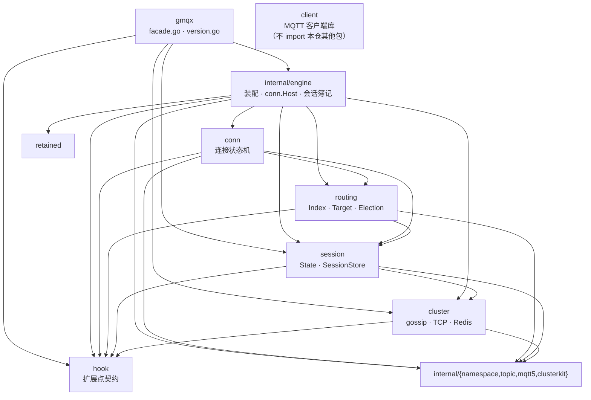
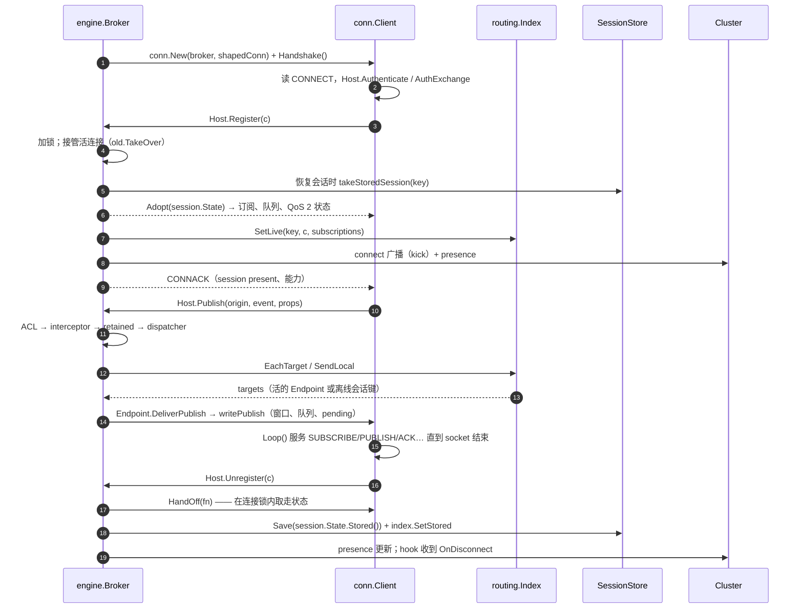
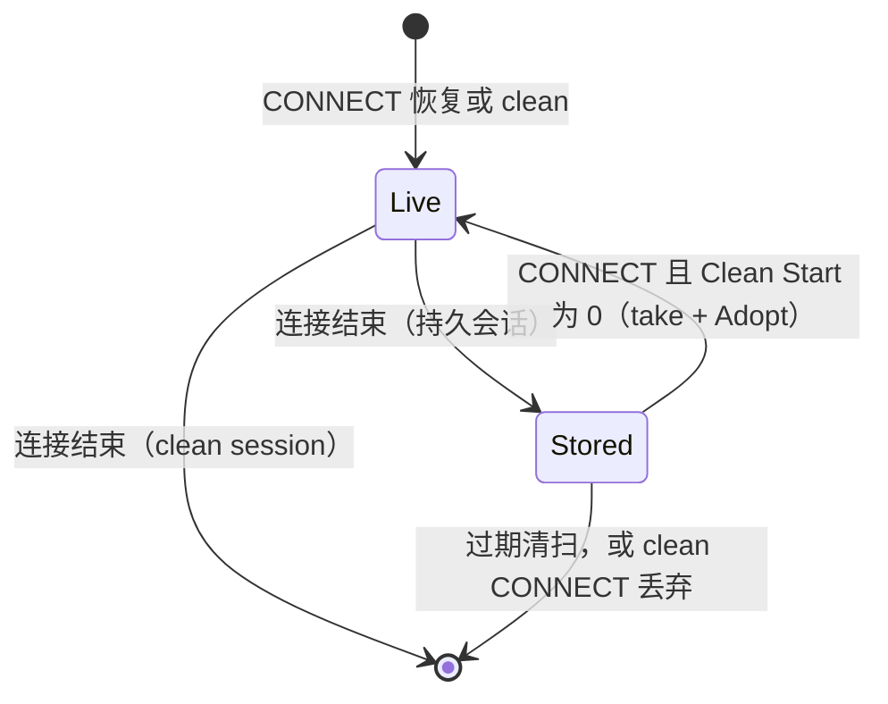

[English](ARCHITECTURE.md) | 简体中文

# 架构：代码在哪里，以及为什么在那里

> 适用于当前代码树（2026-11-02）。规则本身记录在平台仓的 `docs/design/source-layout.md`；本文是本仓的
> 包级地图。

gmqx 只有一个 import 路径和一个引擎。`github.com/maxid/gmqx` 是**唯一公开包**：它不声明任何行为，
只把下面这些包的类型重新导出。其余要么是使用者可以直接 import 的公开角色包——`hook`、`cluster`、
`session`、`routing`、`conn`、`client`、`retained`——要么是 internal。

之所以这样切：broker 不是一件事。一条物理连接、路由表、会话状态、集群后端、扩展契约，各自因为不同的
原因而变。每件事一个包；装配层（`internal/engine`）是唯一同时认识它们的那个地方。

## 包

| 包 | 角色 | 关键声明 |
|---|---|---|
| `gmqx`（根） | **只有门面**：`facade.go` 是包文档与全部别名/转发，`version.go` 是版本。两个非测试文件，无逻辑。 | `Broker`、`Config`、`Publication`、`LocalTarget`、`Dispatcher`、错误值、hook 别名 |
| `internal/engine` | **装配**：broker 生命周期（`New`/`Start`/`Stop`）、clientId 表与接管规则、会话簿记（store 的 take/save/sweep、离线队列与上限）、待发 will 调度、插件宿主，以及 `conn.Host` 的实现。 | `Broker`、`Config`、错误值、`conn.Host` 方法 |
| `conn` | **一条物理连接**：CONNECT/AUTH 握手、读循环、写队列与 writer 协程、出站 QoS 1/2 窗口与单一重传定时器、will 判定、字节速率整形。只通过 `conn.Host` 与 broker 对话。 | `Client`、`Host`、`Limits`、`Origin`、`Handoff`、`Shaping` |
| `routing` | **路由表与共享订阅的节点选举**：精确/通配桶、每 filter 活跃计数、带轮转游标的共享组、离线会话条目，以及“哪个节点投递这条共享发布”的集群选择。持有 `routing.Endpoint`，从不持有连接类型。 | `Index`、`Target`、`Endpoint`、`Election` |
| `session` | **会话状态与其持久化接缝**：在线形态（`State`/`Pending`/`Subscription`/`Inflight`）与存储形态（`SessionState`）及两者之间的投影，`SessionStore` SPI 与内存/Redis 两个实现。 | `State`、`SessionState`、`SessionStore`、`MemorySessionStore`、`RedisSessionStore` |
| `cluster` | **集群后端**：契约与事件类型、gossip（默认）/ TCP mesh / Redis 三个后端，以及可观测视图（`StatsView`、`LinkView`、`PresenceView`、`RoutingView`）。 | `Cluster`、`ClusterMessage`、`NewGossipCluster`、`NewTCPCluster`、`NewRedisCluster` |
| `hook` | **扩展点契约**：认证、ACL、事件 sink、指标、拦截器、连接信息、载荷 codec 与插件宿主槽位。 | `AuthManager`、`AclManager`、`EventSink`、`MetricsManager`、`Interceptor`、`Codec`、`Host` |
| `retained` | **保留消息表**（含过期）；使用它的策略在 broker 里。 | `Store` |
| `client` | **MQTT 客户端库**（主动连出的一侧），与 broker 无关：不 import 本仓任何其他包。 | `Client`、`Config` |
| `internal/{namespace,topic,mqtt5,clusterkit}` | 共享规则而不是角色：键的命名空间、主题过滤器、MQTT 5 属性与订阅标识规则、集群去重与摘要。 | — |

## 依赖方向



三条规则撑起这个形状，而且都是编译期强制的：

1. **没人 import 根包。** 箭头只会离开 `gmqx`。子包 import 根包就是环，或者说明它想要的那个类型本该在
   子包里。
2. **引擎 import 角色包；角色包从不 import 引擎。** `internal/engine` 可以调 `conn`、`routing`、
   `session`、`cluster`；反过来没有人调它。连接对 broker 的需求是 `conn.Host` **接口**，由
   `*engine.Broker` 实现——所以 `conn` 不知道引擎存在，测试可以用一个很小的假 host 跑一条连接。
3. **只有根包公开，引擎在 `internal/`。** `go doc github.com/maxid/gmqx` 就是 API；
   `github.com/maxid/gmqx/internal/engine` 模块外不可 import。根包的别名让 `gmqx.Broker` 与
   `engine.Broker` 是同一个类型。

## 一条连接的一生



两个细节是承重的：

- **会话交接是一个临界区。** `conn.Client.HandOff`（接管时是 `TakeOver`）在持有连接锁的情况下运行
  broker 的回调，回调返回之后连接才不再拥有自己的队列。这才使“状态已保存”和“新投递进入离线队列”
  互斥：投递不可能落在一条会话刚被写出的 socket 上。
- **路由看到的是接口，不是连接。** `routing.Endpoint` 只有 `ClientID()`、`ConnectionID()` 与
  `DeliverPublish(...)`——表真正需要的三件事，以及那个让“被顶替连接的 SUBSCRIBE 被忽略”的身份比较。

## 会话在哪里



会话处于 **Live** 时由 `conn.Client` 拥有：订阅、CONNACK 之后排空的队列、入站 QoS 2 的 packet id 与
出站 exchange。连接结束时 `HandOff` 把它变成 `session.State`，引擎再存下投影（`SessionState`）——
store 与在线表从不同时持有同一个键，这正是“一条发布恰好到达离线会话一次”的原因。恢复是它的逆过程：
`takeStoredSession` 原子地取走键，`Adopt` 装到新连接上，并让未确认的 exchange 按原 packet id 重传。

## 想改什么，去哪里

| 我想改… | 包 |
|---|---|
| CONNECT/AUTH 交换、读写循环、线上的一条 PUBLISH | `conn` |
| 出站 QoS 1/2 窗口、重传、packet id 分配 | `conn` |
| 主题匹配到哪些会话、共享组成员轮转 | `routing` |
| “哪个节点投递这条共享发布”的集群选择 | `routing`（`Election`） |
| 会话在重连之间保留什么、存储编码 | `session` |
| `SessionStore` 契约或自带的两个 store | `session` |
| broker 生命周期、connect mode、接管、限额、偏移 | `internal/engine` |
| 会话簿记、离线队列上限、过期清扫 | `internal/engine` |
| 延迟 will、插件宿主、cluster 适配器 | `internal/engine` |
| 扩展契约（认证、ACL、sink、指标、codec） | `hook` |
| 集群后端或其线上格式 | `cluster` |
| 主动连出的 MQTT 客户端 | `client` |

当一次改动横跨其中两个包时，边界通常就是答案：连接需要 broker 多做一件事，那是加一个 `conn.Host`
方法 + `internal/engine` 里的适配器；路由表需要连接多暴露一个属性，那是加一个 `routing.Endpoint`
方法。

## 读树的顺序

```
gmqx/
  facade.go version.go      公开包：只有别名与转发
  internal/engine/          装配：Broker、conn.Host、会话簿记、will、插件
  conn/                     一条物理连接及其状态机
  routing/                  路由表与共享订阅的节点选举
  session/                  会话状态与 SessionStore 接缝
  cluster/                  gossip / TCP mesh / Redis 三个后端
  hook/                     扩展点契约
  retained/                 保留消息表
  client/                   MQTT 客户端库
  internal/{namespace,topic,mqtt5,clusterkit}   共享规则
  interop/                  独立 module：第三方与参考实现的互操作
  contrib/                  独立 module：扩展 store
  examples/                 可运行示例
  docs/                     本文、性能与持久化
```
